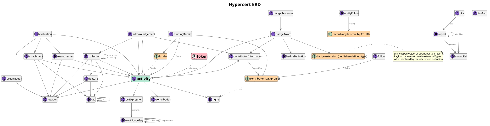
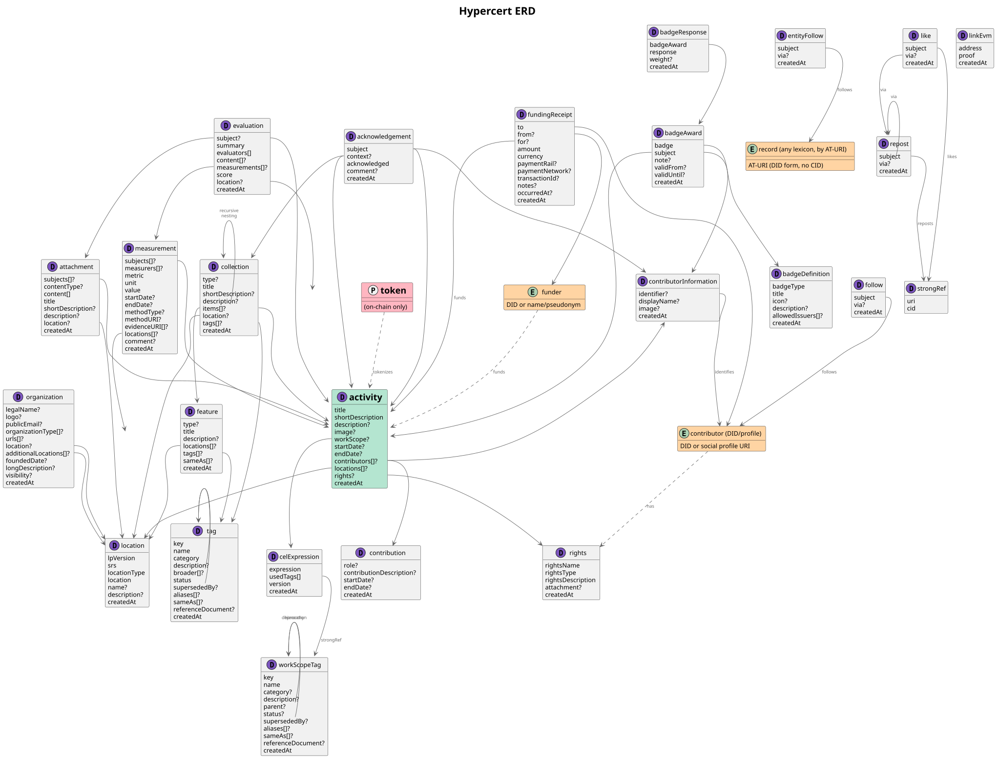

# @hypercerts-org/lexicon

ATProto lexicon definitions and TypeScript types for the
[Hypercerts](https://hypercerts.org) protocol — a system for tracking,
evaluating, and funding impact work on the
[AT Protocol](https://atproto.com) network.

## Lexicon Map

```text
CLAIMS ─ the core impact record and its parts
──────────────────────────────────────────────────────────────────────
  activity ──────────┬──► collection ◄──┐  (recursive nesting)
  (the hypercert)    │       │          │
                     │       ▼          │
                     ├──► contribution          (role, timeframe)
                     ├──► contributorInformation (identity, image)
                     ├──► rights                (licensing terms)
                     └──► workScope
                            ├── cel ───► workscope/tag  (CEL expression over scope tags)
                            └── string          (free-form scope)

GENERAL TAGS ─ governed classification vocabulary
──────────────────────────────────────────────────────────────────────
  collection ─────────────► tag          (plain conjunctive classification)
  tag ────────────────────► tag          (broader / supersededBy)

FEATURES ─ non-agent subjects that claims describe
──────────────────────────────────────────────────────────────────────
  collection ─────────────► feature      (features as collection items)
  feature ────────────────► location     (spatial representations)
  feature ────────────────► tag          (governed classification)

CONTEXT ─ evidence, data, and social verification
──────────────────────────────────────────────────────────────────────
  attachment ─────────────► any record (activity, evaluation, …)
  measurement ────────────► any record (activity, …)
  evaluation ─────────────► any record (activity, measurement, …)
                  └──────► measurement
  acknowledgement ────────► any record  (bidirectional link)

FUNDING ─ payment records
──────────────────────────────────────────────────────────────────────
  receipt ────────────────► activity    (from funder → to recipient)

HYPERBOARDS ─ visual display layer (hyperboards.org)
──────────────────────────────────────────────────────────────────────
  board ──────────────────► activity / collection
    └── contributorConfig ► contributorInformation
  displayProfile            (per-user visual defaults)

CERTIFIED ─ shared lexicons (certified.app)
──────────────────────────────────────────────────────────────────────
  location                  (geo coordinates, GeoJSON, H3, …)
  link/evm                  (ATProto DID ↔ EVM wallet link)
  actor/profile             (user profile)
  actor/organization        (org metadata)
  badge/response ──► badge/award ──► badge/definition
  graph/follow ────────────► account DID  (social follow)
  graph/entityFollow ──────► record (by AT-URI)  (non-account follow)
  feed/like ───────────────► record (by strongRef)  (social like)
  feed/repost ─────────────► record (by strongRef)  (social repost)
  signature/defs            (shared #list, #inline and #createdVia defs)
  signature/proof           (remote attestation proof record)
```

Every arrow (`►`) is a `strongRef` or union reference stored on the
AT Protocol network. Full field-level documentation is in
[SCHEMAS.md](SCHEMAS.md).

## Consuming These Lexicons

If you are building a downstream application on top of these lexicons,
we strongly recommend **NOT** reading from `main` or other development
branches of the repository, but instead via the following published
releases:

- **For TypeScript / JavaScript code** — use [the npm package
  `@hypercerts-org/lexicon`](https://www.npmjs.com/package/@hypercerts-org/lexicon),
  which includes generated types, validation helpers, and schema
  constants.
- **For other languages** — use the [tagged
  releases](https://github.com/hypercerts-org/hypercerts-lexicon/releases)
  published in this GitHub repository.

Both npm releases and git tags follow [SemVer](https://semver.org/).
For npm, you can depend on a version range to receive compatible
updates automatically. For GitHub releases/tags, pin a specific tag
or upgrade manually to a newer compatible SemVer release.

The raw lexicons published on ATProto can also be used, but they are
(unavoidably) missing useful context such as full documentation
(including changelogs), TypeScript type definitions, SemVer
guarantees, git history, and other tooling provided by the packaged
releases.

### AI Agent Skill

If you use AI coding assistants (e.g. Claude Code, OpenCode), you can
install a skill that teaches your agent how to build with these
lexicons:

```bash
npx skills add hypercerts-org/hypercerts-lexicon
```

This installs the
[`building-with-hypercerts-lexicons`](.agents/skills/building-with-hypercerts-lexicons/SKILL.md)
skill, which provides your agent with guidance on package entry points,
TypeScript types, validation, all lexicon schemas, code examples, and
AT Protocol conventions.

## Maintenance and publishing releases

Clearly stability and predictability for users and developers are
essential.

Unfortunately AT Protocol doesn't support any kind of native
versioning or migrations which could support lexicon schema changes.
Instead, the AT Protocol community recommends minimising changes to
lexicons in general, and to avoid breaking changes wherever possible:

- https://atproto.com/guides/lexicon-style-guide
- https://www.pfrazee.com/blog/lexicon-guidance

This project intends to follow that guidance as much as possible
whilst retaining a pragmatic approach. In practice that means:

- Changes to other tooling within this repository which _do not touch
  lexicons_ may be made at any time as long as they follow
  [SemVer](https://semver.org/) to avoid negative impact on
  developers.

- Non-breaking changes to lexicons, such as adding an optional
  property or updating a `description`, may be made sparingly. While
  these changes are backwards-compatible at the protocol level, they
  may still require consuming applications and indexers to update
  their schemas for consistent UX.

- Breaking changes to lexicons will only be made in exceptional
  circumstances. Specifically, a breaking change will only proceed
  **if and only if**:
  - the broader community — not just the Hypercerts core team —
    agrees that the benefits clearly outweigh the cost of the
    breakage, **and**
  - full consideration is given to all affected parties across the
    community and wider ecosystem, not only those involved in the
    decision, **and**
  - no viable alternative exists, such as releasing a new `.v2`
    version of the lexicon or introducing a `v2` field.

  To date, breaking changes have only occurred during the early
  stages of launching Hypercerts on AT Protocol, before external
  consumers were building against the lexicons. We intend to keep
  it that way.

It is also worth noting that members of the ATProto community have
been working on tooling to make these problems easier to deal with in
future, e.g. see https://panproto.dev/

## Use of branches

`main` is the only evergreen branch and the default branch on GitHub.
We aim to minimise deviations between `main` and versions published on
npm and ATProto. However the publishing processes involve several
moving parts (including third-party systems), and it is technically
impossible to update all three at the same time. So **please do not
assume they will always be perfectly in sync**.

See [docs/PUBLISHING.md](docs/PUBLISHING.md) for the full release workflow.

> If you see a `develop` branch, it is a stale leftover from a
> previous workflow and is no longer used; do not open pull requests
> against it.

## Contributing / development

Please see [CONTRIBUTING.md](CONTRIBUTING.md).

### Project Structure

```text
lexicons/               Source of truth (committed)
  org/hypercerts/         Hypercerts protocol lexicons
  org/hyperboards/        Hyperboards visual layer lexicons
  app/certified/          Shared/certified lexicons
  com/atproto/            ATProto external references

generated/              Auto-generated TypeScript (gitignored)
dist/                   Built bundles (gitignored)
scripts/                Build and codegen scripts
```

> **Never edit `generated/` or `dist/` directly** — they are
> regenerated from lexicon JSON files.

## Installation

```bash
npm install @hypercerts-org/lexicon
```

## Quick Start

```typescript
import {
  HYPERCERTS_SCHEMAS,
  ACTIVITY_NSID,
  validate,
} from "@hypercerts-org/lexicon";
import { Agent } from "@atproto/api";

const agent = new Agent({ service: "https://bsky.social" });

// Register lexicons with the agent
agent.api.lex.add(...HYPERCERTS_SCHEMAS);

// Build a record
const record = {
  $type: ACTIVITY_NSID,
  title: "Reforestation in Amazon Basin 2024",
  shortDescription: "Planted 5,000 native trees across 12 hectares",
  createdAt: new Date().toISOString(),
};

// Validate before writing
const result = validate(record, ACTIVITY_NSID, "main");
if (!result.success) throw new Error(String(result.error));

// Write to the network
await agent.api.com.atproto.repo.createRecord({
  repo: agent.session?.did,
  collection: ACTIVITY_NSID,
  record,
});
```

## Lexicon Reference

### Claims (`org.hypercerts.claim.*`)

| Lexicon                     | NSID                                          | Description                                                                                                                            |
| --------------------------- | --------------------------------------------- | -------------------------------------------------------------------------------------------------------------------------------------- |
| **Activity**                | `org.hypercerts.claim.activity`               | The main hypercert record — describes impact work with title, description, contributors, work scope, timeframe, locations, and rights. |
| **Contribution**            | `org.hypercerts.claim.contribution`           | Details about a specific contribution: role, description, and timeframe.                                                               |
| **Contributor Information** | `org.hypercerts.claim.contributorInformation` | Identity record for a contributor: identifier (DID or URI), display name, and image.                                                   |
| **Rights**                  | `org.hypercerts.claim.rights`                 | Licensing and rights terms (e.g. "CC BY-SA 4.0") attached to an activity.                                                              |

### Collections (`org.hypercerts.*`)

| Lexicon        | NSID                        | Description                                                                                                                                                                                                                 |
| -------------- | --------------------------- | --------------------------------------------------------------------------------------------------------------------------------------------------------------------------------------------------------------------------- |
| **Collection** | `org.hypercerts.collection` | A named, weighted group of activities, features, and/or other collections. Supports recursive nesting. Used for projects, portfolios, favourites, funding rounds, etc. Carries optional governed classification via `tags`. |

### Features (`org.hypercerts.entity.feature`)

| Lexicon     | NSID                            | Description                                                                                                                                                                                                                                                                                                                                                                                                              |
| ----------- | ------------------------------- | ------------------------------------------------------------------------------------------------------------------------------------------------------------------------------------------------------------------------------------------------------------------------------------------------------------------------------------------------------------------------------------------------------------------------ |
| **Feature** | `org.hypercerts.entity.feature` | A subject record for non-agent things that claims describe — for example a land zone or an ecological stratum. Carries identity (`title`, coarse `type`), long-form `description`, governed classification (`tags`), optional spatial representations (`locations` → `app.certified.location`), exact entity concordance (`sameAs`), and `createdAt`. Grouping stays in collections; geometry stays in location records. |

### General Tags (`org.hypercerts.vocab.tag`)

| Lexicon | NSID                       | Description                                                                                                                                                                                                                                                                                                                                                                                                                                                                                                 |
| ------- | -------------------------- | ----------------------------------------------------------------------------------------------------------------------------------------------------------------------------------------------------------------------------------------------------------------------------------------------------------------------------------------------------------------------------------------------------------------------------------------------------------------------------------------------------------- |
| **Tag** | `org.hypercerts.vocab.tag` | A reusable governed vocabulary term for classifying records, with category, lifecycle status, supersession, aliases, exact-match `sameAs` links to external vocabularies, optional `broader` strong references to one or more directly broader terms, and an optional `referenceDocument` URI or attached small blob that defines or motivates the term. Referenced from `collection.tags` and `feature.tags` as plain conjunctive facts. Distinct from `org.hypercerts.workscope.tag`, which is unchanged. |

### Context (`org.hypercerts.context.*`)

| Lexicon             | NSID                                     | Description                                                                                |
| ------------------- | ---------------------------------------- | ------------------------------------------------------------------------------------------ |
| **Attachment**      | `org.hypercerts.context.attachment`      | Project updates, standalone updates by their author, reports, evidence, or other material. |
| **Measurement**     | `org.hypercerts.context.measurement`     | Quantitative data point (metric + unit + value) linked to one or more records.             |
| **Evaluation**      | `org.hypercerts.context.evaluation`      | An assessment of a record with evaluators, summary, score, and supporting measurements.    |
| **Acknowledgement** | `org.hypercerts.context.acknowledgement` | Bidirectional link: confirms or rejects inclusion of a record in another context.          |

### Work Scope (`org.hypercerts.workscope.*`)

| Lexicon            | NSID                           | Description                                                                                                                       |
| ------------------ | ------------------------------ | --------------------------------------------------------------------------------------------------------------------------------- |
| **Tag**            | `org.hypercerts.workscope.tag` | Reusable scope atom (topic, domain, method, …) with taxonomy support, aliases, and linked ontologies.                             |
| **CEL Expression** | `org.hypercerts.workscope.cel` | Structured work scope using [CEL](https://github.com/google/cel-spec) expressions over tags. Embedded inline in activity records. |

### Funding (`org.hypercerts.funding.*`)

| Lexicon     | NSID                             | Description                                                                                                                                                                                                                                                                                                                                                                                                                                              |
| ----------- | -------------------------------- | -------------------------------------------------------------------------------------------------------------------------------------------------------------------------------------------------------------------------------------------------------------------------------------------------------------------------------------------------------------------------------------------------------------------------------------------------------- |
| **Receipt** | `org.hypercerts.funding.receipt` | Records a payment to a recipient: the gross `amount` the sender paid and/or the `netAmount` received, each with its own currency, plus one payment rail and network for the receipt and an optional transaction ID. The sender (`from`) is optional to support anonymous funders, an optional `type` says whether the payment is a donation, a match or a grant, and an optional `via` names the intermediary that facilitated or processed the payment. |

### Hyperboards (`org.hyperboards.*`)

| Lexicon             | NSID                             | Description                                                                                                                         |
| ------------------- | -------------------------------- | ----------------------------------------------------------------------------------------------------------------------------------- |
| **Board**           | `org.hyperboards.board`          | Visual presentation layer wrapping an activity or collection with background, colors, aspect ratio, and per-contributor styling.    |
| **Display Profile** | `org.hyperboards.displayProfile` | Per-user visual defaults (avatar, hover image, video, click-through URL) reusable across boards. Singleton record (`literal:self`). |

### Certified (`app.certified.*`)

| Lexicon              | NSID                               | Description                                                                                                                                                                                                                                                                                        |
| -------------------- | ---------------------------------- | -------------------------------------------------------------------------------------------------------------------------------------------------------------------------------------------------------------------------------------------------------------------------------------------------- |
| **Location**         | `app.certified.location`           | Geographic reference using the [Location Protocol](https://spec.decentralizedgeo.org) (coordinates, GeoJSON, H3, WKT, etc.).                                                                                                                                                                       |
| **Profile**          | `app.certified.actor.profile`      | User account profile with display name, bio, avatar, and banner.                                                                                                                                                                                                                                   |
| **Organization**     | `app.certified.actor.organization` | Organization metadata: legal name, full logo, public email, legal structure, URLs, primary and additional locations, founding date, optional long description, and discoverability visibility.                                                                                                     |
| **Badge Definition** | `app.certified.badge.definition`   | Defines a badge type with title, icon, and optional issuer allowlist.                                                                                                                                                                                                                              |
| **Badge Award**      | `app.certified.badge.award`        | Awards a badge to a user, project, or activity, with an optional validity window.                                                                                                                                                                                                                  |
| **Badge Response**   | `app.certified.badge.response`     | Recipient accepts or rejects a badge award.                                                                                                                                                                                                                                                        |
| **EVM Link**         | `app.certified.link.evm`           | Verifiable ATProto DID ↔ EVM wallet link via EIP-712 signature. Extensible for future proof methods (e.g. ERC-1271, ERC-6492).                                                                                                                                                                     |
| **Follow**           | `app.certified.graph.follow`       | Social-graph follow relationship — declares that the author follows another account by DID. Schema-compatible with `app.bsky.graph.follow`.                                                                                                                                                        |
| **Entity Follow**    | `app.certified.graph.entityFollow` | Social-graph follow relationship for non-account entities (e.g. a record, referenced by AT-URI without a CID so the follow survives updates). Account (DID) follows remain in `app.certified.graph.follow`; `subject` is an open union so future non-DID entity kinds can be added non-breakingly. |
| **Like**             | `app.certified.feed.like`          | Social feedback on any record, referenced by strongRef. Optional `via` credits the repost it was found through. Schema-compatible with `app.bsky.feed.like`.                                                                                                                                       |
| **Repost**           | `app.certified.feed.repost`        | Resurfaces any record (by strongRef, pinned to the version seen) to the reposter's followers. Optional `via` traces repost chains. Schema-compatible with `app.bsky.feed.repost`.                                                                                                                  |

### Signatures (`app.certified.signature.*`)

| Lexicon         | NSID                            | Description                                                                                                                                                                                                                                                                                                                                               |
| --------------- | ------------------------------- | --------------------------------------------------------------------------------------------------------------------------------------------------------------------------------------------------------------------------------------------------------------------------------------------------------------------------------------------------------- |
| **Shared Defs** | `app.certified.signature.defs`  | Shared type definitions for signatures. Provides the `#list` array def (an open union of inline signatures and strongRefs), the `#createdVia` object def (the application that wrote this version of the record) and the `#inline` object def (signed by the holder of `key`, in no stated role), all referenced by the `signatures` property on records. |
| **Proof**       | `app.certified.signature.proof` | Remote attestation proof record containing the CID of attested content. Lives in the attestor's repository and can be referenced via strongRef.                                                                                                                                                                                                           |

All record lexicons include an optional `signatures` property (a ref to `app.certified.signature.defs#list`) enabling cryptographic attestations. See [Cryptographic Signatures](#cryptographic-signatures) for usage details.

Note on `app.certified.link.evm`: it carries _two_ orthogonal integrity primitives. The EIP-712 `proof` field proves wallet consent (the EVM key holder agreed to be linked to the DID). A `#createdVia` signature in the `signatures` array proves record provenance (e.g. that a platform UI minted the record, defending against replay of harvested EIP-712 signatures). Both are useful and they do not conflict.

> **Full property tables** → [SCHEMAS.md](SCHEMAS.md)

## Schema Conventions

A few conventions are worth knowing before you start emitting records,
because they affect what counts as a "valid" record vs. one that breaks
interop with the wider ecosystem.

### `knownValues` is an open vocabulary, not a closed enum

When you see `"knownValues": [...]` on a string field, those values are
**conventions for interoperability, not constraints.** Lexicon validators
do not reject values outside the list. The vocabulary is intentionally
open so applications can extend it with domain-specific variants without
waiting for a schema bump.

If the lexicon authors wanted a field to be closed, they would have used
`enum` instead — which the validator does enforce.

In practice:

- **Prefer a `knownValues` entry** when one matches your semantics. It
  guarantees other Hypercerts-aware consumers (indexers, AppViews,
  search facets, dropdown UIs) will recognize the value without
  per-app special-casing.
- **Custom values are permitted** when no listed value fits. The record
  is still wire-valid. Consumers that filter on the canonical list
  simply won't categorize the value; consumers that read the raw string
  will see whatever you wrote.
- **Custom values are at-your-own-risk for interop.** A custom
  `locationType: "geojson-polygon"`, for example, is a perfectly valid
  record — but a downstream tool that buckets by the Location Protocol
  registry will treat it as "other". Use the closest `knownValues`
  entry (here, `geojson`, which is the catch-all for non-Point GeoJSON)
  when you want canonical bucketing.

When a `knownValues` list grows in a way that's broadly useful, open a
PR to add the new entry to the lexicon — that's how the canonical list
stays in sync with real-world usage.

### `strongRef` pins to a specific record version

Fields typed as `com.atproto.repo.strongRef` carry both `uri` AND `cid`.
The `cid` is a content hash that pins the reference to the exact record
version at the time the reference was written — if the referenced
record is later overwritten, consumers can detect that the reference
has drifted.

This matters when you might otherwise be tempted to embed a full record
by value to "snapshot" it. A strongRef + CID already provides the
snapshot semantic, and it's what the lexicon uses across
`badge.award.badge`, `badge.response.badgeAward`, `funding.receipt.for`,
and similar fields where the historical content needs to stay stable.

### `langs` declares what language a record's text was written in

Records whose text a person writes — `org.hypercerts.collection`,
`org.hypercerts.claim.activity`, `org.hypercerts.context.attachment`,
`org.hypercerts.entity.feature`, `app.certified.actor.profile` and
`app.certified.actor.organization` — carry an optional `langs` array of up
to three BCP-47 language tags, the same shape as Bluesky's
`app.bsky.feed.post` `langs`. It says which language(s) the record's title
and descriptions were written in, so an app can decide what to translate
and which language to index it under. It is an array because one record
can mix languages.

- **Store only the original.** The record carries the language the author
  wrote in. Translations do not go on the record.
- **Set it when writing, from the text.** Detect the language of what the
  author wrote, show the result, and let the author correct it. Never write
  the interface language or a profile preference alone: an author with a
  Spanish interface who writes in English must not be tagged `es`.
- **Read it as a hint.** It is self-declared and can be wrong. Never hide a
  record because it lacks `langs` or because the tag looks wrong; detect
  the language yourself for records without it.
- **Prefer language codes to region codes** (`es`, not `es-MX`) unless the
  text really differs by region.

## Entity Relationship Diagram



<details>
<summary>View ERD with field details</summary>



</details>

## Usage

### Accessing NSIDs

Individual constants (recommended):

```typescript
import {
  ACTIVITY_NSID,
  HYPERCERTS_COLLECTION_NSID,
} from "@hypercerts-org/lexicon";
```

Semantic object:

```typescript
import { HYPERCERTS_NSIDS } from "@hypercerts-org/lexicon";

const id = HYPERCERTS_NSIDS.ACTIVITY;
```

Type-based mapping:

```typescript
import { HYPERCERTS_NSIDS_BY_TYPE } from "@hypercerts-org/lexicon";

const id = HYPERCERTS_NSIDS_BY_TYPE.OrgHypercertsClaimActivity;
```

Lightweight bundle (no TypeScript types, smaller bundle):

```typescript
import { schemas, validate, ids } from "@hypercerts-org/lexicon/lexicons";
```

### TypeScript Types

```typescript
import { OrgHypercertsClaimActivity } from "@hypercerts-org/lexicon";

const activity: OrgHypercertsClaimActivity.Main = {
  $type: "org.hypercerts.claim.activity",
  title: "My Impact Work",
  shortDescription: "...",
  createdAt: new Date().toISOString(),
};
```

### Lexicon Documents

```typescript
import {
  ACTIVITY_LEXICON_JSON, // raw JSON (untyped)
  ACTIVITY_LEXICON_DOC, // LexiconDoc (typed)
} from "@hypercerts-org/lexicon";
```

Or via semantic mapping objects:

```typescript
import {
  HYPERCERTS_LEXICON_JSON,
  HYPERCERTS_LEXICON_DOC,
} from "@hypercerts-org/lexicon";

const doc = HYPERCERTS_LEXICON_DOC.ACTIVITY;
```

### Record schemas for `@atproto/lex` (`/records`)

`@hypercerts-org/lexicon/records` exports lex-compatible schemas for the
modern [`@atproto/lex`](https://www.npmjs.com/package/@atproto/lex) client,
in lex's own layout: the NSID namespace tree (`app`, `com`, `org`, `pub`),
as in the `@atproto/lex` documentation. Use it to create, validate and type
records with `Client`.

```typescript
import { Client } from "@atproto/lex";
import { app, org } from "@hypercerts-org/lexicon/records";

const client = new Client(session); // an authenticated agent or session

await client.create(org.hypercerts.claim.activity, {
  title: "Reforestation in the Amazon Basin 2026",
  shortDescription: "Planting native trees on degraded pasture.",
  createdAt: new Date().toISOString(),
});

type Activity = org.hypercerts.claim.activity.Main; // the record type
type Uri = org.hypercerts.defs.Uri; // another definition

const result = org.hypercerts.claim.activity.$safeParse(input);
if (app.certified.badge.award.$isTypeOf(record)) {
  // record is a badge award
}
```

- **Names are NSIDs.** Every lexicon except permission sets sits at its
  NSID path. When the lexicon defines `main`, that definition is the schema
  and `.Main` its type; other definitions are named as in the lexicon.
- **Deep imports** use the NSID path without a file extension:
  `@hypercerts-org/lexicon/records/org/hypercerts/claim/activity` (the
  lexicon's module) or `.../activity.defs` (its definitions).
- **Published as ESM.** TypeScript resolves the types with
  `moduleResolution` `nodenext`, `node16` or `bundler` (not `node10`, which
  `@atproto/lex` does not support either).
- **`@atproto/lex` ^0.4.2** is an optional peer dependency: install it to
  use `/records`. The range follows the `@atproto/lex` version the schemas
  are generated with. The root and `/lexicons` entry points are unchanged
  and do not need it.
- The root package's `OrgHypercertsClaimActivity` and similar namespaces are
  the older `@atproto/lex-cli` types; they are not lex schemas and cannot be
  passed to `Client`.

## Examples

### Creating Activities with Work Scope

```typescript
import { ACTIVITY_NSID } from "@hypercerts-org/lexicon";

const activity = {
  $type: ACTIVITY_NSID,
  title: "Mangrove Restoration in Mombasa",
  shortDescription: "Restored 3 hectares of mangrove forest",
  // Structured work scope via CEL expression:
  workScope: {
    $type: "org.hypercerts.workscope.cel",
    expression:
      "scope.hasAll(['mangrove_restoration']) && location.country == 'KE'",
    usedTags: [
      {
        uri: "at://did:plc:alice/org.hypercerts.workscope.tag/3k2abc",
        cid: "...",
      },
    ],
    version: "v1",
    createdAt: new Date().toISOString(),
  },
  startDate: "2024-01-01T00:00:00Z",
  endDate: "2024-12-31T23:59:59Z",
  createdAt: new Date().toISOString(),
};
```

### Creating Collections (Projects, Portfolios, etc.)

```typescript
import { HYPERCERTS_COLLECTION_NSID } from "@hypercerts-org/lexicon";

const project = {
  $type: HYPERCERTS_COLLECTION_NSID,
  type: "project",
  title: "Carbon Offset Initiative",
  shortDescription: "Activities focused on carbon reduction and reforestation",
  tags: [
    // Optional governed classification — references to org.hypercerts.vocab.tag records:
    {
      uri: "at://did:plc:vocab/org.hypercerts.vocab.tag/outcome-class.carbon",
      cid: "...",
    },
  ],
  items: [
    {
      itemIdentifier: {
        uri: "at://did:plc:alice/org.hypercerts.claim.activity/3k2abc",
        cid: "...",
      },
    },
    {
      itemIdentifier: {
        uri: "at://did:plc:bob/org.hypercerts.claim.activity/7x9def",
        cid: "...",
      },
    },
    // Collections can contain other collections (recursive nesting):
    {
      itemIdentifier: {
        uri: "at://did:plc:carol/org.hypercerts.collection/4m5ghi",
        cid: "...",
      },
    },
  ],
  createdAt: new Date().toISOString(),
};
```

### Creating Feature Records (Zones, Strata)

```typescript
import { ENTITY_FEATURE_NSID } from "@hypercerts-org/lexicon";

const feature = {
  $type: ENTITY_FEATURE_NSID,
  type: "zone",
  title: "North restoration area",
  locations: [
    {
      uri: "at://did:plc:alice/app.certified.location/3k2abc",
      cid: "...",
    },
  ],
  tags: [
    {
      uri: "at://did:plc:vocab/org.hypercerts.vocab.tag/zone-role.site",
      cid: "...",
    },
  ],
  createdAt: new Date().toISOString(),
};
```

### Creating Tag Records (Governed Vocabulary)

```typescript
import { VOCAB_TAG_NSID } from "@hypercerts-org/lexicon";

const tag = {
  $type: VOCAB_TAG_NSID,
  key: "site",
  name: "Project site",
  category: "zone-role",
  status: "accepted",
  description: "A managed area where restoration activity takes place.",
  createdAt: new Date().toISOString(),
};
```

### Creating Location Records

```typescript
import { LOCATION_NSID } from "@hypercerts-org/lexicon";

// Decimal coordinates
const location = {
  $type: LOCATION_NSID,
  lpVersion: "1.0",
  srs: "http://www.opengis.net/def/crs/OGC/1.3/CRS84",
  locationType: "coordinate-decimal",
  location: {
    $type: "app.certified.location#string",
    string: "-3.4653, -62.2159",
  },
  name: "Amazon Research Station",
  createdAt: new Date().toISOString(),
};

// GeoJSON
const geoLocation = {
  $type: LOCATION_NSID,
  lpVersion: "1.0",
  srs: "http://www.opengis.net/def/crs/OGC/1.3/CRS84",
  locationType: "geojson-point",
  location: {
    $type: "app.certified.location#string",
    string: '{"type":"Point","coordinates":[-62.2159,-3.4653]}',
  },
  name: "Research Station Alpha",
  createdAt: new Date().toISOString(),
};
```

### Acknowledging Inclusion

When one user includes another's record (e.g. adding an activity to a
collection), the owner can confirm or reject with an acknowledgement:

```typescript
import { CONTEXT_ACKNOWLEDGEMENT_NSID } from "@hypercerts-org/lexicon";

const ack = {
  $type: CONTEXT_ACKNOWLEDGEMENT_NSID,
  subject: {
    uri: "at://did:plc:bob/org.hypercerts.claim.activity/3k2abc",
    cid: "bafy...",
  },
  // context is a union — use $type to specify the variant
  context: {
    $type: "com.atproto.repo.strongRef",
    uri: "at://did:plc:alice/org.hypercerts.collection/7x9def",
    cid: "bafy...",
  },
  acknowledged: true, // false to reject
  createdAt: new Date().toISOString(),
};
```

### Creating Attachments

Attachments may include up to 20 `tags` strong references to
`org.hypercerts.vocab.tag` records. All tags apply simultaneously (logical
AND), without ordering, weighting, negation, or inheritance. Tags classify
the attachment; they do not establish verification or evidence quality.

Optional `capturedAt` records when the attached material was captured (for
example, when a photo was taken), separately from `createdAt`, the record's
creation time. It is a standard atproto `datetime`, so it must include timezone
information (`Z` or an offset such as `+12:00`). If only a local time without
offset or only a date is known, omit the field rather than inventing an offset.
Also omit it for multi-capture material without one truthful shared value; it
is not a coverage interval. See [capture-time design notes](docs/design/attachment-capture-time.md).

```typescript
import { CONTEXT_ATTACHMENT_NSID } from "@hypercerts-org/lexicon";

const attachment = {
  $type: CONTEXT_ATTACHMENT_NSID,
  title: "Field Survey Report",
  contentType: "report",
  subjects: [
    {
      uri: "at://did:plc:alice/org.hypercerts.claim.activity/abc123",
      cid: "...",
    },
  ],
  // content items are a union — use $type to specify the variant
  content: [
    {
      $type: "org.hypercerts.defs#uri",
      uri: "https://example.com/reports/survey-2024.pdf",
    },
    { $type: "org.hypercerts.defs#uri", uri: "ipfs://Qm..." },
  ],
  shortDescription: "Quarterly field survey documenting project progress",
  langs: ["en"],
  createdAt: new Date().toISOString(),
};
```

### Standalone updates and posts

A standalone update by its author, a personal or organization post that is
not about any particular project, is an attachment whose `subjects` point at
the author's own `app.certified.actor.profile`: an update about the author.
People and organizations both use their profile record. Project updates are
the same record with `subjects` pointing at the project or activity. One
record type carries both, so a feed, a like, a repost, or a translation works
the same way for either. Use `contentType: "update"` for narrative updates;
the documentary kinds (`report`, `audit`, `evidence`, `testimonial`,
`methodology`) are for material about the subjects. A profile is edited over
time, so match a profile subject by its `uri`, not its `cid`.

```typescript
import { CONTEXT_ATTACHMENT_NSID } from "@hypercerts-org/lexicon";

const update = {
  $type: CONTEXT_ATTACHMENT_NSID,
  title: "Primeras lluvias en el vivero",
  contentType: "update",
  // the author's own profile: an update about the author
  subjects: [
    {
      uri: "at://did:plc:alice/app.certified.actor.profile/self",
      cid: "...",
    },
  ],
  shortDescription: "Las plántulas de encino ya tienen hojas nuevas.",
  description: {
    $type: "org.hypercerts.defs#descriptionString",
    value: "Después de tres semanas de sequía, las primeras lluvias...",
  },
  content: [
    {
      $type: "org.hypercerts.defs#uri",
      uri: "https://example.com/photos/vivero-octubre.jpg",
    },
  ],
  createdAt: new Date().toISOString(),
};
```

### Cryptographic Signatures

All record lexicons support optional cryptographic signatures via the `signatures` property. Each signature's `$type` says what it attests:

1. **`app.certified.signature.defs#createdVia`**: the application that wrote this version of the record signs it inline. It means "written through this application", not "this application vouches for the content". Feeds and indexers can filter on it. Any change outside `signatures` breaks it; the application that makes the change replaces it with its own. A record carries at most one; applications enforce this, the lexicon does not.
2. **`app.certified.signature.defs#inline`**: signed by the holder of `key`. It says only that the key holder signed this version of the record, not in what role.
3. **Remote attestations**: references to `app.certified.signature.proof` records in other repositories, via `com.atproto.repo.strongRef`.

The union is open. An application can define its own signature type in its own namespace, and consumers ignore types they do not recognize.

The on-the-wire shape, signing procedure, and verification procedure all conform to Nick Gerakines' [ATProtocol Attestation Specification](https://tangled.org/strings/did:plc:cbkjy5n7bk3ax2wplmtjofq2/3m3fy2xuahc22) (see also the [accompanying blog post](https://ngerakines.leaflet.pub/3m3idxul5hc2r)). In particular, signatures sign the **CID** of the record (not its raw bytes), and CID generation injects a temporary `$sig` object: the signature entry itself without its `signature` bytes, plus the DID of the repository that holds the record. The signature therefore covers the entry's `$type` (its meaning) and `key`, and cannot be replayed across content versions or across repositories.

#### Signing Algorithm

The spec mandates **ECDSA** with the low-S variant per BIP-0062. The signing curve is determined by the multicodec prefix of the verification method's `publicKeyMultibase` in the signer's DID document:

| Multicodec prefix | Curve             | JOSE alg |
| ----------------- | ----------------- | -------- |
| `0xE701`          | secp256k1 (K-256) | `ES256K` |
| `0x1200`          | P-256 (secp256r1) | `ES256`  |

There is deliberately no `signatureType` field on the inline signature: the algorithm is canonically derived from the resolved key, and a separate tag would risk disagreeing with the multicodec.

> **Key management.** The platform signing keypair is a long-lived identity, not a per-record artefact. It MUST be generated once, persisted in secure storage (HSM, KMS, sealed secret, etc.), and reused across every signed record so that the public key resolved from the `key` DID-URL stays stable for verifiers. Generating a fresh keypair per signature (the "throwaway key" anti-pattern) defeats verification: nobody can confirm that two records came from the same signer, and the `did:key:` in `key` will not match anything any verifier has previously seen or pinned.

#### Step 1: Load (or Create) the Platform Signing Keypair

Use `exportable: true` so the private key bytes can be written to your secret store, then reload them on every subsequent process start. The example below performs an in-memory round trip via `export()` / `import()` to demonstrate the API surface — in production, replace the round trip with real reads and writes against your KMS / sealed-secret store:

```typescript
import { Secp256k1Keypair } from "@atproto/crypto";

// First-run bootstrap: generate, export, persist.
const fresh = await Secp256k1Keypair.create({ exportable: true });
const privateKeyBytes = await fresh.export(); // 32 raw bytes
// e.g. await kms.putSecret("hypercerts/platform-signing-key", privateKeyBytes);

// Every subsequent process load: read bytes from the store and rehydrate.
// e.g. const privateKeyBytes = await kms.getSecret("hypercerts/platform-signing-key");
const keypair = await Secp256k1Keypair.import(privateKeyBytes);
```

#### Step 2: Build a `createdVia` Signature

Compute the spec-defined CID over the record-to-be-signed, then ECDSA-sign it with the platform's key. Uses [`@atproto/crypto`](https://www.npmjs.com/package/@atproto/crypto) (ATProto's signing primitives — handles low-S automatically), [`@ipld/dag-cbor`](https://www.npmjs.com/package/@ipld/dag-cbor) for canonical encoding, and [`multiformats`](https://www.npmjs.com/package/multiformats) for CID construction:

```typescript
import * as dagCbor from "@ipld/dag-cbor";
import { CID } from "multiformats/cid";
import { sha256 } from "multiformats/hashes/sha2";
import { ACTIVITY_NSID } from "@hypercerts-org/lexicon";

// 1. The record we want to sign (without the signatures field).
const recordToSign = {
  $type: ACTIVITY_NSID,
  title: "Verified Reforestation Project",
  shortDescription: "Planted 1,000 trees in partnership with local community",
  createdAt: "2026-05-21T12:00:00.000Z",
};

// 2. The DID of the repository that will hold the record. When an
//    application writes on a user's behalf, this is the user's DID,
//    not the application's.
const repositoryDid = "did:plc:user123";

// 3. The signature entry without its signature bytes. `key` names the
//    signing key. In production it points into the application's own
//    DID document (e.g. "did:web:app.example#platform-signing"), so
//    verifiers can tell which application signed; this example uses
//    the keypair's did:key.
const signerDid = keypair.did();
if (!signerDid.startsWith("did:key:")) {
  throw new Error(`Expected did:key signer, got ${signerDid}`);
}
const signerKey = `${signerDid}#${signerDid.slice("did:key:".length)}`;
const unsignedEntry = {
  $type: "app.certified.signature.defs#createdVia" as const,
  key: signerKey,
};

// 4. Insert temporary $sig: the entry itself plus the repository DID.
//    This binds the signature to its meaning ($type), its key and the
//    repository, preventing relabeling and cross-repo replay.
const cborInput = {
  ...recordToSign,
  $sig: { ...unsignedEntry, repository: repositoryDid },
};

// 5. Encode canonically as DAG-CBOR, then build the 36-byte CIDv1
//    (dag-cbor codec 0x71 + SHA-256 multihash).
const cborBytes = dagCbor.encode(cborInput);
const hash = await sha256.digest(cborBytes);
const cid = CID.createV1(dagCbor.code, hash);
const cidBytes = cid.bytes; // 36 bytes: 0x01 0x71 0x12 0x20 + 32-byte hash

// 6. ECDSA-sign the CID bytes with the persisted keypair from Step 1.
//    Keypair.sign() applies the standard ECDSA hash-then-sign convention
//    and enforces low-S per BIP-0062.
const signatureBytes = await keypair.sign(cidBytes);

const createdViaSignature = { ...unsignedEntry, signature: signatureBytes };
```

#### Step 3: Build a Remote Attestation Reference (Optional)

Only if the attestation lives in another repo's proof record:

```typescript
const remoteAttestation = {
  $type: "com.atproto.repo.strongRef" as const,
  uri: "at://did:plc:verifier/app.certified.signature.proof/abc123",
  cid: "bafy...", // CID returned when the proof record was written (see Remote Attestation Proofs)
};
```

#### Step 4: Attach to the Record

Both shapes can coexist in the same array; consumers verify each entry independently.

```typescript
const signedActivity = {
  ...recordToSign,
  signatures: [createdViaSignature, remoteAttestation],
};
```

#### Verifying a Signature

To **verify** an inline signature, rebuild `$sig` from the entry as stored: the entry without its `signature` field, plus the DID of the repository that holds the record. Do not rebuild it from a fixed list of fields; any field on the entry is part of what was signed. Then rebuild the CID the same way, resolve `key` to a public key via the DID document, and check the ECDSA signature against the CID bytes. This works for any inline signature type, including types defined by other applications:

```typescript
import { verifySignature } from "@atproto/crypto";

// verifySignature takes a did:key, which is its own public key. For
// did:web or did:plc, fetch the DID document and turn the verification
// method that `key` names into a did:key (atproto keys are Multikeys).
//
// This is an example, not a production resolver. The record's author
// chooses `key`, and so the host this fetches. A server that verifies
// records from anyone must also refuse hosts that resolve to private
// addresses, set a timeout, and cache DID documents.
async function resolveSigningKey(key: string): Promise<string> {
  const [did, fragment] = key.split("#");
  if (did.startsWith("did:key:")) return did;
  let url: string;
  if (did.startsWith("did:web:")) {
    // atproto supports only hostname-level did:web, so a path is
    // rejected. A port is encoded as %3A and passes.
    const id = did.slice("did:web:".length);
    if (id.includes(":")) throw new Error(`Unsupported did:web path: ${did}`);
    url = `https://${decodeURIComponent(id)}/.well-known/did.json`;
    // A did:web names a domain, never an IP address or localhost.
    const { hostname } = new URL(url);
    if (
      hostname === "localhost" ||
      hostname.startsWith("[") ||
      /^[\d.]+$/.test(hostname)
    ) {
      throw new Error(`did:web host is not a domain name: ${did}`);
    }
  } else if (did.startsWith("did:plc:")) {
    url = `https://plc.directory/${did}`;
  } else {
    throw new Error(`Unsupported DID method: ${did}`);
  }
  // A redirect would let the DID's host send the request elsewhere.
  const response = await fetch(url, { redirect: "error" });
  if (!response.ok) throw new Error(`Could not resolve ${did}`);
  const doc = await response.json();
  const method = doc.verificationMethod?.find(
    (m: { id: string }) => m.id === key || m.id === `#${fragment}`,
  );
  if (!method?.publicKeyMultibase) {
    throw new Error(`${key} is not in the DID document`);
  }
  return `did:key:${method.publicKeyMultibase}`;
}

// Inline entries carry key and signature; strongRef entries do not.
const storedEntry = signedActivity.signatures.find(
  (entry): entry is typeof createdViaSignature =>
    entry.$type === "app.certified.signature.defs#createdVia" &&
    "key" in entry &&
    "signature" in entry,
);
if (!storedEntry) throw new Error("Record has no #createdVia signature");
const { signatures: _stored, ...recordWithoutSignatures } = signedActivity;
const { signature: storedSignature, ...sigMetadata } = storedEntry;
const rebuiltCid = CID.createV1(
  dagCbor.code,
  await sha256.digest(
    dagCbor.encode({
      ...recordWithoutSignatures,
      $sig: { ...sigMetadata, repository: repositoryDid },
    }),
  ),
);

const verified = await verifySignature(
  await resolveSigningKey(storedEntry.key),
  rebuiltCid.bytes,
  storedSignature,
);
```

#### Remote Attestation Proofs

For remote attestations, create a proof record in the attestor's repository. Its `cid` is the CID of the attested record with `$sig` set to the proof record itself without `cid`, plus the DID of the repository that holds the attested record. Every other field of the proof is therefore signed, so set them all before computing the CID:

```typescript
import { SIGNATURE_PROOF_NSID } from "@hypercerts-org/lexicon";

const proofWithoutCid = {
  $type: SIGNATURE_PROOF_NSID,
  note: "Verified by platform quality assurance process",
  createdAt: new Date().toISOString(),
};
const proofCid = CID.createV1(
  dagCbor.code,
  await sha256.digest(
    dagCbor.encode({
      ...recordToSign,
      $sig: { ...proofWithoutCid, repository: repositoryDid },
    }),
  ),
);

const proof = { ...proofWithoutCid, cid: proofCid.toString() };

// The strongRef to this proof must carry the proof record's own CID (the
// one returned when the attestor writes it), not proofCid, which
// identifies the attested content. A record's CID is the DAG-CBOR CIDv1
// of the record, so it can also be computed locally:
const proofRecordCid = CID.createV1(
  dagCbor.code,
  await sha256.digest(dagCbor.encode(proof)),
);
const proofReference = {
  $type: "com.atproto.repo.strongRef" as const,
  uri: "at://did:plc:verifier/app.certified.signature.proof/abc123",
  cid: proofRecordCid.toString(),
};
```

For the full specification, see Nick Gerakines' [ATProtocol Attestation Specification](https://tangled.org/strings/did:plc:cbkjy5n7bk3ax2wplmtjofq2/3m3fy2xuahc22). For background and motivation, see the [accompanying blog post](https://ngerakines.leaflet.pub/3m3idxul5hc2r).

## Development

### Commands

```bash
npm run gen-api       # Regenerate TypeScript types from lexicons
npm run build         # Build distributable bundles (ESM, CJS, types)
npm run check         # Validate + typecheck + build (run before committing)
npm run lint          # Check formatting (Prettier + ESLint)
npm run format        # Auto-fix formatting
npm run gen-schemas-md # Regenerate SCHEMAS.md
npm run test          # Run tests
```

### Following another account

The `app.certified.graph.follow` record is the social-graph primitive
for `certified.app`. Its shape is identical to `app.bsky.graph.follow`
(same `key: tid`, same `subject` / `createdAt` / optional `via`
fields), so feed-builders and view services can index it with the
same logic they already use for Bluesky follows.

```typescript
import { GRAPH_FOLLOW_NSID } from "@hypercerts-org/lexicon";

const follow = {
  $type: GRAPH_FOLLOW_NSID,
  // DID of the account being followed (any valid DID — did:plc, did:web, etc.)
  subject: "did:plc:ewvi7nxzyoun6zhxrhs64oiz",
  createdAt: new Date().toISOString(),
  // Optional `via` strongRef — set when the follow was mediated by another
  // record (e.g. a starter-pack-style curated list). Omit for direct follows.
  // via: {
  //   uri: "at://did:plc:ewvi7nxzyoun6zhxrhs64oiz/app.certified.graph.starterpack/3k2abc",
  //   cid: "bafyreigh2akiscaildcqabsyg3dfr6chu3fgpregiymsck7e7aqa4s52zy",
  // },
};
```

The optional `via` field is a `com.atproto.repo.strongRef` to any
record that mediated the follow (e.g. a starter pack or other curated
list), mirroring the equivalent field on `app.bsky.graph.follow`.

### Following a non-account entity

`app.certified.graph.entityFollow` is the sibling of
`app.certified.graph.follow` for following anything that is **not** an
account. Account (DID) follows are explicitly out of scope here — use
`app.certified.graph.follow` for those. Today the only subject variant
is `app.certified.defs#recordSubject`, a record referenced by AT-URI
(DID form, no CID), so the reference survives later updates to the
record. `subject` is an open union so additional non-DID entity kinds
can be added in the future without a breaking change.

```typescript
import { GRAPH_ENTITY_FOLLOW_NSID } from "@hypercerts-org/lexicon";

const entityFollow = {
  $type: GRAPH_ENTITY_FOLLOW_NSID,
  // subject is a union — use $type to specify the variant
  subject: {
    $type: "app.certified.defs#recordSubject",
    uri: "at://did:plc:alice/org.hypercerts.claim.activity/3k2abc",
  },
  createdAt: new Date().toISOString(),
  // Optional `via` strongRef — same semantics as on `app.certified.graph.follow`.
  // via: {
  //   uri: "at://did:plc:alice/app.certified.graph.starterpack/3k2abc",
  //   cid: "bafyreigh2akiscaildcqabsyg3dfr6chu3fgpregiymsck7e7aqa4s52zy",
  // },
};
```

### Liking and reposting records

`app.certified.feed.like` and `app.certified.feed.repost` are the feed
primitives for `certified.app`. Their shapes are identical to
`app.bsky.feed.like` and `app.bsky.feed.repost` (same `key: tid`, same
`subject` / `createdAt` / optional `via` fields), so feed-builders and
view services can index them with the same logic they already use for
Bluesky likes and reposts. A like is social feedback only — it carries
no protocol meaning about the subject and is not an evaluation or
acknowledgement.

`subject` is a `com.atproto.repo.strongRef` to a record of any lexicon.
The CID pins the version the author saw; indexers that count likes or
reposts should group by `subject.uri`.

```typescript
import { FEED_LIKE_NSID, FEED_REPOST_NSID } from "@hypercerts-org/lexicon";

const repost = {
  $type: FEED_REPOST_NSID,
  subject: {
    uri: "at://did:plc:alice/org.hypercerts.claim.activity/3k2abc",
    cid: "bafyreigh2akiscaildcqabsyg3dfr6chu3fgpregiymsck7e7aqa4s52zy",
  },
  createdAt: new Date().toISOString(),
};

const like = {
  $type: FEED_LIKE_NSID,
  subject: {
    uri: "at://did:plc:alice/org.hypercerts.claim.activity/3k2abc",
    cid: "bafyreigh2akiscaildcqabsyg3dfr6chu3fgpregiymsck7e7aqa4s52zy",
  },
  createdAt: new Date().toISOString(),
  // Optional `via` strongRef — set when the subject was encountered through
  // someone else's repost, so the AppView can credit the reposter. Omit for
  // likes made directly on the subject.
  // via: {
  //   uri: "at://did:plc:bob/app.certified.feed.repost/3k2def",
  //   cid: "bafyreigh2akiscaildcqabsyg3dfr6chu3fgpregiymsck7e7aqa4s52zy",
  // },
};
```

The optional `via` field on both records is a strongRef to the record
through which the subject was encountered — typically an
`app.certified.feed.repost` — mirroring the equivalent field on
`app.bsky.feed.like` and `app.bsky.feed.repost`.

### Linking ATProto Identity to EVM Wallets

The `app.certified.link.evm` record enables verifiable linking between
an ATProto DID and an EVM wallet address. The link is proven via a
cryptographic signature, allowing any verifier to confirm that the
wallet owner authorized the binding. Currently supports EOA wallets
via EIP-712 typed data signatures; the `proof` field is an open union
to allow future signature methods (e.g. ERC-1271, ERC-6492).

```typescript
import { LINK_EVM_NSID } from "@hypercerts-org/lexicon";

const evmLinkRecord = {
  $type: LINK_EVM_NSID,
  address: "0xd8dA6BF26964aF9D7eEd9e03E53415D37aA96045",
  proof: {
    $type: "app.certified.link.evm#eip712Proof",
    signature: "0xabc123...", // truncated for readability; real signatures are 130-132 hex chars
    message: {
      $type: "app.certified.link.evm#eip712Message",
      did: "did:plc:alice",
      evmAddress: "0xd8dA6BF26964aF9D7eEd9e03E53415D37aA96045",
      chainId: "1",
      timestamp: "1709500000",
      nonce: "0",
    },
  },
  createdAt: new Date().toISOString(),
};
```

**Key fields:**

- `address` (required): 0x-prefixed EVM wallet address (EIP-55
  checksummed, 42 chars)
- `proof` (required): Open union containing the cryptographic proof of
  wallet ownership. Each variant bundles its signature with the
  corresponding message format. Currently the only variant is
  `#eip712Proof` for EOA wallets.
- `createdAt` (required): Timestamp when the record was created

## License

MIT
